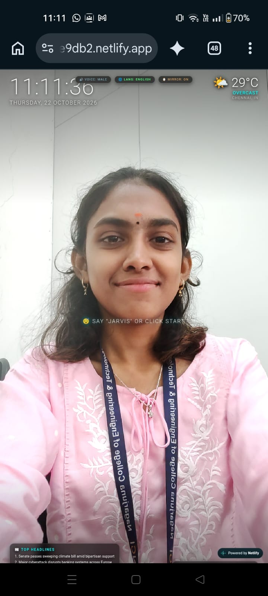
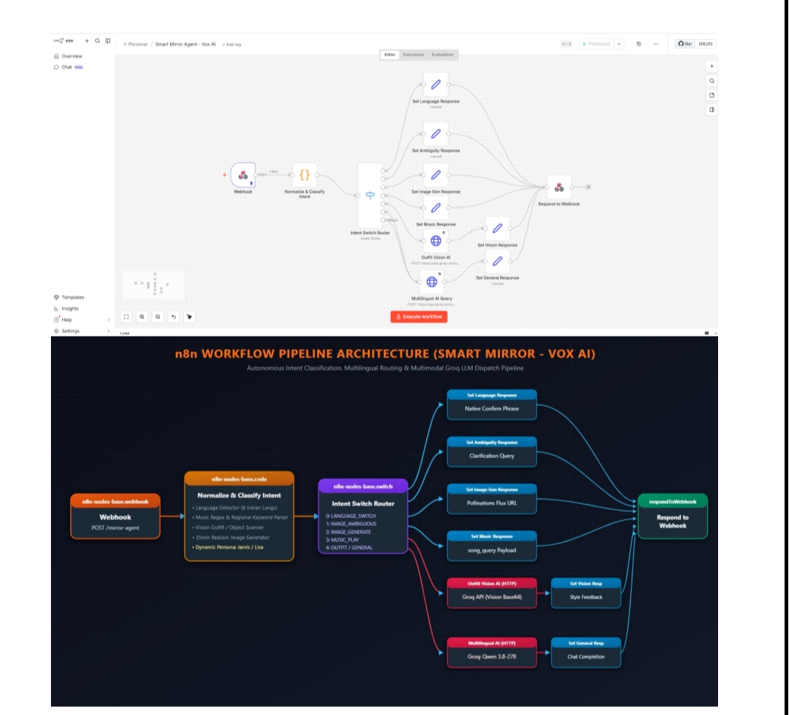

# SmartMirror-Vox
### Voice-Augmented Magic Mirror for Smart Environments

An intelligent, multimodal smart mirror integrating Artificial Intelligence, Computer Vision, Generative AI, and multilingual voice interaction to create a context-aware personal assistant.

---

## 1. Project Overview

SmartMirror-Vox is an AI-powered smart mirror designed to transform a conventional reflective surface into an intelligent, interactive system.

Unlike traditional smart mirrors that primarily display static information, SmartMirror-Vox enables users to communicate naturally through voice commands, interact with AI-powered services, analyze their appearance, identify objects, and generate virtual hairstyle previews.

The system combines a web-based interface, Python Flask backend, n8n workflow orchestration, and external AI services to provide a unified multimodal experience.

**Core capabilities:**
- Multilingual voice-based conversations.
- AI-powered outfit and appearance analysis.
- Real-time object identification through camera input.
- Generative AI-based virtual hairstyle previews.
- Voice-activated music and multimedia interaction.
- Dynamic conversational personalities.

## 2. System Demonstration

### Live Smart Mirror Interface



*The deployed interface demonstrating the smart mirror dashboard, camera interaction, voice assistant controls, weather information, and user interface.*

### System Architecture and Workflow



*The system architecture and n8n automation pipeline showing intent classification, request routing, AI processing, and response delivery.*

## 3. Key Features

| Feature | Implementation |
|---|---|
| Voice Interaction | Browser-based speech recognition and voice responses |
| Multilingual Communication | English, Kannada, Telugu, Hindi, Tamil, Malayalam, Marathi, Bengali |
| Conversational AI | Groq and Google Gemini |
| Assistant Personalities | Jarvis and Lisa |
| Outfit Analysis | Vision-language model-based appearance feedback |
| Object Identification | Camera-based visual understanding |
| Virtual Hairstyle Generation | FLUX.1 / Pollinations image-generation pipeline |
| Music Interaction | Voice-based music request processing |
| Smart Dashboard | Clock, date, weather and news information |
| Workflow Orchestration | n8n webhook and intent-based routing |

## 4. Technology Stack

**Frontend**
- HTML5
- CSS3
- JavaScript
- Web Speech Recognition API
- MediaDevices API
- Web Audio API

**Backend**
- Python
- Flask
- Flask-CORS
- Requests
- Pillow

**Artificial Intelligence**
- Groq
- Google Gemini
- Qwen-VL
- Vision-Language Models
- FLUX.1
- Pollinations

**Automation and Integration**
- n8n
- Webhooks
- REST APIs
- JSON-based workflow processing

**Deployment and Version Control**
- Netlify
- Git
- GitHub

## 5. System Architecture

The application follows a modular, event-driven architecture consisting of four logical components.

### 5.1 Presentation Layer

The frontend provides the primary interaction interface.

Responsibilities:
- Displaying the smart mirror dashboard.
- Showing time, date, weather, and news.
- Capturing voice commands.
- Accessing camera input.
- Displaying AI-generated responses and images.
- Playing audio responses and music.

### 5.2 Backend Layer – Python Flask

The Flask application acts as the backend controller.

Responsibilities:
- Managing conversational sessions.
- Maintaining active language and assistant preferences.
- Handling frontend and external API communication.
- Supporting audio streaming and music-related operations.
- Coordinating requests between application components.

### 5.3 Workflow Orchestration Layer – n8n

The n8n workflow coordinates the processing of user requests.

The workflow consists of:

1. **Webhook:** Receives the incoming request.
2. **Normalize and Classify:** Processes user text and identifies the requested operation.
3. **Intent Switch Router:** Selects the appropriate execution path.
4. **Processing Branches:** Handles language changes, general questions, outfit analysis, image generation, and music requests.
5. **Response Processing:** Prepares the result.
6. **Respond to Webhook:** Returns the structured response to the application.

### 5.4 AI and External Services Layer

External AI services provide the intelligence required by the application.

- Groq and Google Gemini – Conversational responses.
- Qwen-VL / Gemini Vision – Visual understanding and analysis.
- FLUX.1 / Pollinations – Generative image processing.
- Speech-to-Text and Text-to-Speech services – Voice interaction.
- External APIs – Weather, news, and multimedia services.

## 6. Request Processing Workflow

```text
             USER
               |
               v
       VOICE COMMAND INPUT
               |
               v
        SPEECH RECOGNITION
               |
               v
       SMART MIRROR FRONTEND
               |
               v
        PYTHON FLASK SERVER
               |
               v
          n8n WEBHOOK
               |
               v
       NORMALIZE USER INPUT
               |
               v
       INTENT CLASSIFICATION
               |
               v
        INTENT SWITCH ROUTER
               |
       +-------+-------+--------+
       |       |       |        |
       v       v       v        v
     GENERAL  OUTFIT  IMAGE    MUSIC
      QUERY   ANALYSIS GENERATION REQUEST
       |       |       |        |
       +-------+-------+--------+
               |
               v
       RESPONSE PROCESSING
               |
               v
       RESPOND TO WEBHOOK
               |
               v
       SMART MIRROR DISPLAY
               |
         +-----+-----+
         |           |
         v           v
      TEXT       VOICE OUTPUT
      RESPONSE
```

## 7. Supported Voice Interaction

The system supports eight languages:

| Language | Support |
|---|---|
| English | Yes |
| Kannada | Yes |
| Telugu | Yes |
| Hindi | Yes |
| Tamil | Yes |
| Malayalam | Yes |
| Marathi | Yes |
| Bengali | Yes |

Users can interact with the assistant using the Jarvis or Lisa conversational personality.

## 8. Project Structure

```text
Smart-Mirror/
│
├── .github/
│   └── workflows/
│
├── services/
│
├── assets/
│   ├── smartmirror-live-demo.jpg
│   └── smartmirror-architecture.jpg
│
├── app.py
├── index.html
├── mirror.html
│
├── requirements.txt
├── workflow_smartmirror_vox.json
│
├── netlify.toml
├── _headers
├── _redirects
├── .gitignore
├── start_mirror.bat
│
└── README.md
```

## 9. Installation and Execution

### Prerequisites

- Python 3.9 or later.
- Git.
- pip package manager.
- Modern web browser.
- n8n instance.
- Required external AI service credentials.

### Step 1: Clone the Repository

```bash
git clone <YOUR_REPOSITORY_URL>
```

### Step 2: Navigate to the Project

```bash
cd Smart-Mirror
```

### Step 3: Create a Virtual Environment

```bash
python -m venv venv
```

### Step 4: Activate the Environment

Windows:

```bash
venv\Scripts\activate
```

### Step 5: Install Dependencies

```bash
pip install -r requirements.txt
```

### Step 6: Configure the Automation Workflow

1. Start or access your n8n instance.
2. Import `workflow_smartmirror_vox.json`.
3. Configure the required AI service credentials.
4. Configure the webhook endpoint.
5. Ensure that the Flask backend and frontend use the correct endpoint.

### Step 7: Start the Flask Application

```bash
python app.py
```

Openhe local application address configured by the Flask server in your browser.

Allow microphone and camera permissions when prompted.

Note: External AI services require their corresponding credentials and working API endpoints. The application also requires the n8n workflow to be configured for the associated automation features.

10. Python Dependencies

The project uses the following Python packages:

Package

Purpose

Flask

Backend application framework

Flask-CORS

Cross-origin request handling

Requests

HTTP communication with external services

Pillow

Image processing

Install all dependencies using:

pip install -r requirements.txt

11. Engineering Highlights

This project brings together several important software engineering and AI concepts:

Multimodal AI: Combining text, voice, and visual inputs.

Computer Vision: Using camera input for visual analysis.

Generative AI: Producing AI-generated hairstyle previews.

Workflow Automation: Implementing intent-based request routing through n8n.

Backend Development: Managing application state and API communication with Flask.

API Integration: Connecting multiple external AI and information services.

Modular Architecture: Separating frontend, backend, workflow orchestration, and AI services.

12. Future Scope

Integration with additional IoT sensors and smart home devices.

Personalized user profiles and preference management.

Improved multilingual speech recognition.

Expanded computer vision capabilities.

Additional AI-powered personal assistance features.

Enhanced scalability and real-time processing.

13. Project Team

Institution: Nagarjuna College of Engineering and Technology, Bengaluru
Department: Computer Science and Engineering (Artificial Intelligence & Machine Learning)
Project: Major Project – Phase 2
Course Code: 23CIP77
Project Guide: Dr. Niranjan

Name

USN

H. Sharath

1NC23CI022

K. Rishitha

1NC23CI025

V. Swetha

1NC23CI061

Koushik Yadav

1NC23CI067

<p align="center">
  <b>SmartMirror-Vox</b><br/>
  Intelligent Interaction. Multimodal Intelligence. Smarter Environments.
</p>
